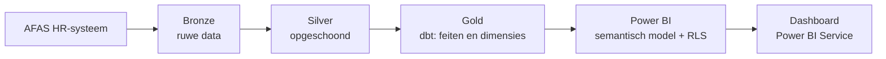
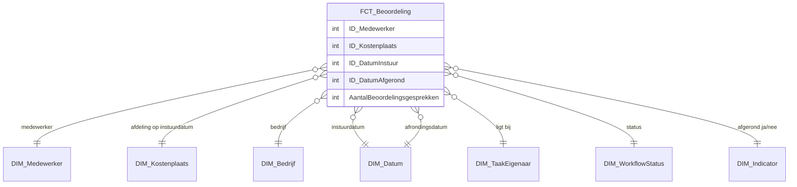
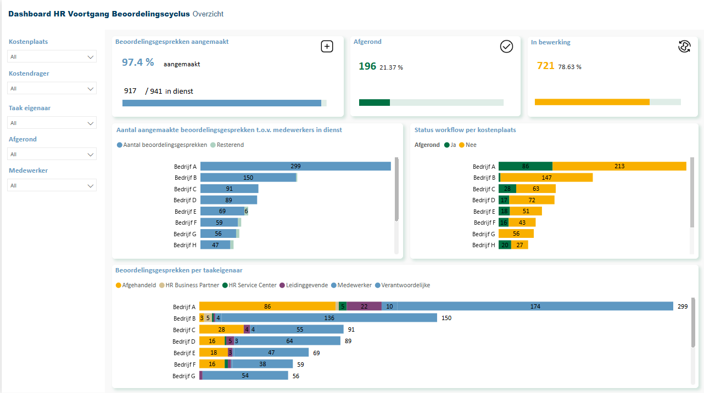
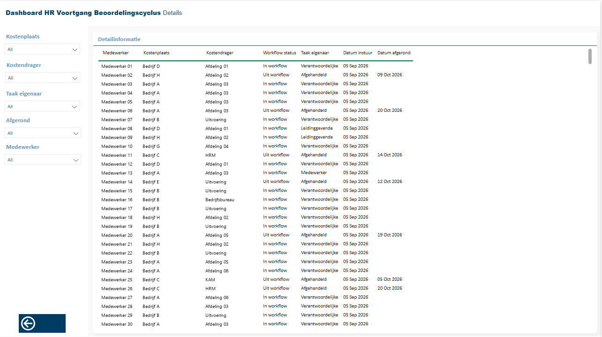

# Beoordelingscyclus – HR-dashboard in Power BI

> Portfolio-case. Alle namen, aantallen en screenshots zijn geanonimiseerd. De getoonde SQL is een vereenvoudigde, zelf geschreven versie en geen kopie van productiecode.

## In één oogopslag

| | |
| --- | --- |
| **Vraag van de business** | HR en leidinggevenden hadden geen overzicht van welke beoordelingsgesprekken zijn ingestuurd, waar ze in de workflow vastzitten en welke afdelingen achterlopen. |
| **Oplossing** | Een sterschema op het centrale dataplatform en een Power BI-dashboard met voortgang per bedrijf, afdeling (kostenplaats) en taakeigenaar. |
| **Mijn rol** | Informatiebehoefte ophalen, datamodel bouwen in dbt, semantisch model en dashboard maken, toegang en RLS inrichten, uitrol naar Power BI Service. |
| **Tools** | Microsoft Fabric · dbt · SQL · Power BI · Tabular Editor · Microsoft Entra ID · Git / Azure DevOps |
| **Bron** | HR-systeem (AFAS): dossieritems met workflowstatus en medewerkerfuncties |

## Van vraag naar dashboard

1. **Informatiebehoefte** – met HR vastgesteld welke vragen het dashboard moet beantwoorden:
   - Hoeveel gesprekken zijn ingestuurd en hoeveel zijn afgerond?
   - Bij welke taakeigenaar (medewerker, leidinggevende, HR) ligt een gesprek nu?
   - Welke afdelingen lopen achter?
2. **Datamodel** – één feitentabel met één rij per beoordelingsdossier, gekoppeld aan gedeelde dimensies.
3. **Laden** – via de medaillonarchitectuur in Microsoft Fabric (bronze → silver → gold).
4. **Semantisch model** – measures in DAX, opmaak gestandaardiseerd met Tabular Editor-macro's.
5. **Beveiliging** – Row-Level Security per bedrijf/kostenplaats; toegang via Entra-groepen.
6. **Uitrol** – feature branch → pull request → review → publicatie in Power BI Service.

## Architectuur



## Datamodel (sterschema)



## Belangrijkste ontwerpkeuzes

| Keuze | Waarom |
| --- | --- |
| **Eén rij per dossier, alleen de laatste versie** | Een dossier kan meerdere keren worden ingestuurd; tellen zonder ontdubbelen gaf te hoge aantallen. |
| **Afdeling bepalen op de instuurdatum (point-in-time)** | Medewerkers wisselen van afdeling. Het gesprek hoort bij de afdeling waar iemand werkte toen het werd ingestuurd, niet bij de huidige. |
| **Terugvallen op de laatst bekende afdeling** | Bij administratieve vertraging in het HR-systeem valt een gesprek anders in "Onbekend". |
| **Twee datumrollen (instuur en afgerond)** | Maakt doorlooptijd en "afgerond per maand" mogelijk met één datumdimensie. |
| **Onbekende sleutels naar 0** | Elke feitregel blijft zichtbaar; ontbrekende koppelingen zijn te herkennen in plaats van stil weg te vallen. |

### Vereenvoudigd voorbeeld van de point-in-time-koppeling

```sql
-- Laatste versie per dossier
WITH dossiers AS (
    SELECT *,
           ROW_NUMBER() OVER (PARTITION BY dossier_id ORDER BY instuurdatum DESC) AS rang
    FROM {{ source('hr', 'dossieritems') }}
)
SELECT d.dossier_id,
       f.afdeling,
       1 AS aantal_gesprekken
FROM dossiers d
-- Afdeling zoals die gold op de instuurdatum
OUTER APPLY (
    SELECT TOP 1 mf.afdeling
    FROM {{ source('hr', 'medewerker_functie') }} mf
    WHERE mf.medewerker_id = d.medewerker_id
      AND mf.begindatum <= d.instuurdatum
    ORDER BY mf.begindatum DESC
) f
WHERE d.rang = 1;
```

## Dashboard

| Pagina | Wat zie je |
| --- | --- |
| Overzicht | Aangemaakte gesprekken t.o.v. medewerkers in dienst, afgerond vs. in bewerking, workflowstatus en taakeigenaar per bedrijf |
| Details | Per medewerker: kostenplaats, kostendrager, workflowstatus, taakeigenaar, instuur- en afrondingsdatum |




## Resultaat

- HR ziet per afdeling hoeveel gesprekken openstaan en bij wie ze liggen.
- <!-- Vul aan: bijv. "vervangt een handmatige Excel-lijst" of "wekelijks gebruikt in het HR-overleg" -->

## Wat ik heb geleerd

- Historische juistheid (point-in-time) vraagt expliciete keuzes die je met de business afstemt.
- Toegang via RLS werkt alleen als rollen en Entra-groepen tegelijk worden beheerd.
